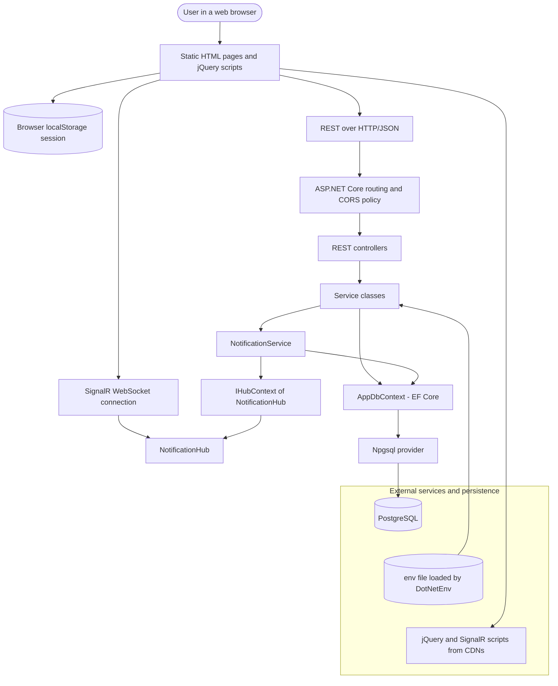
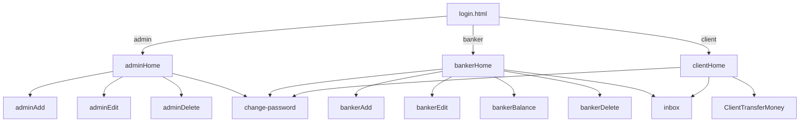
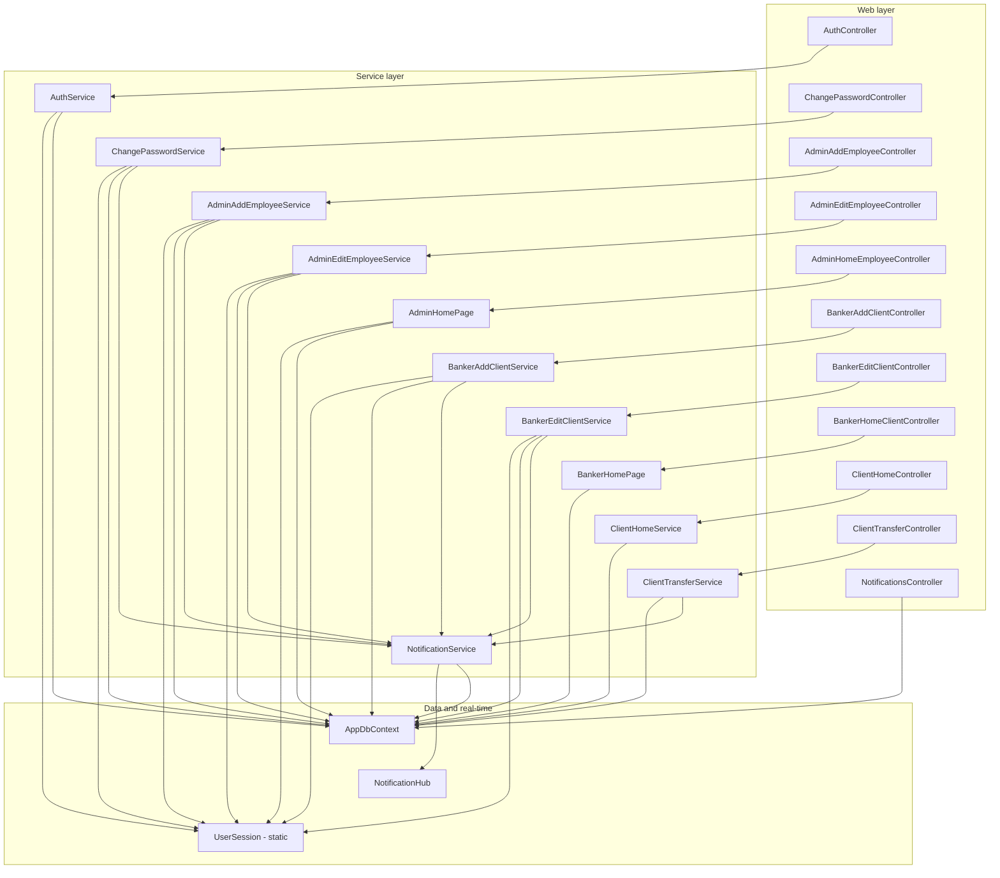
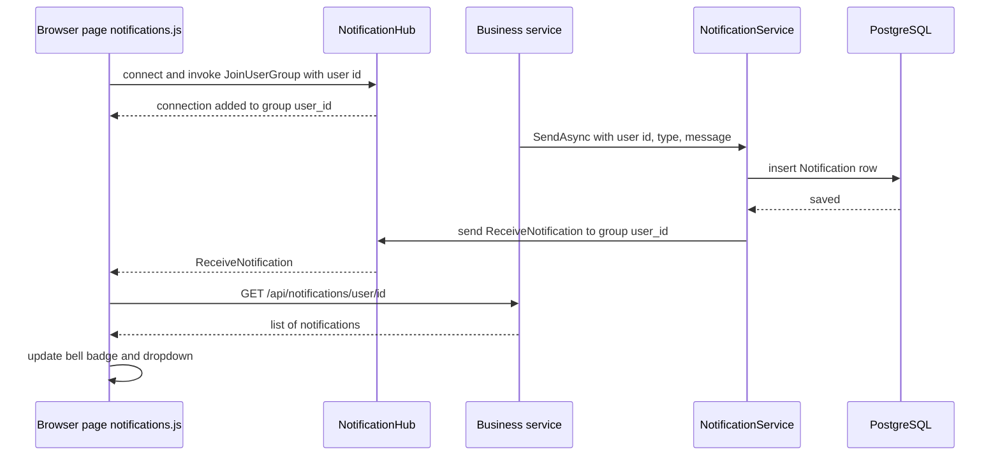
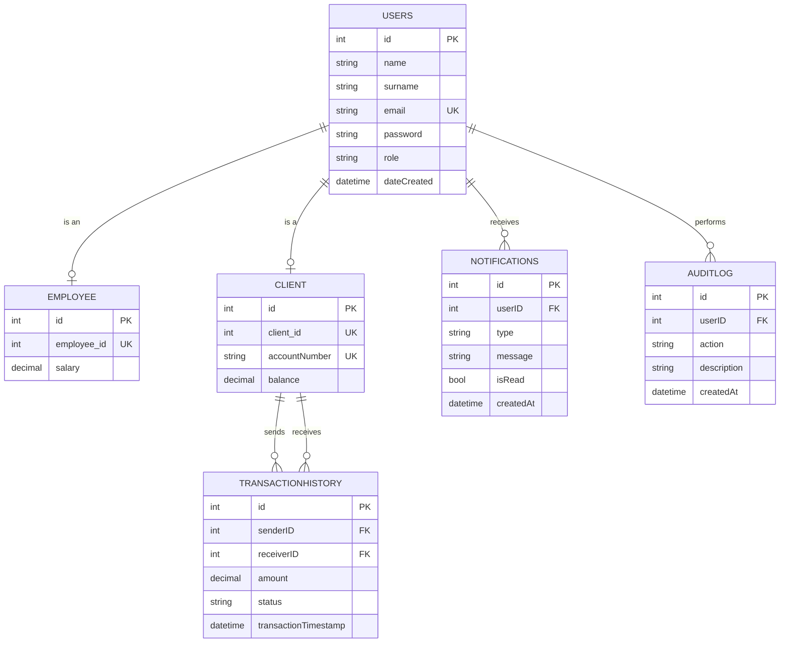
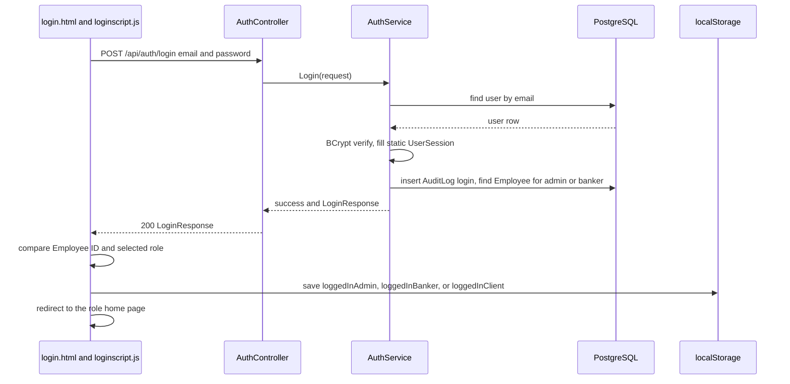
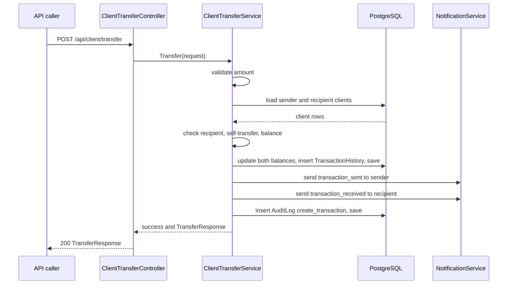
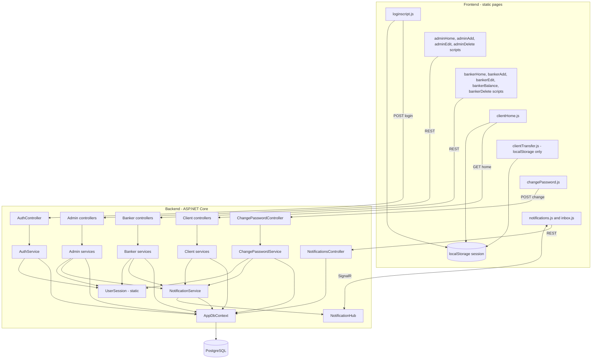

# GoldStone Bank — Role-Based Banking Web Application

GoldStone Bank is a role-based banking web application built around an ASP.NET Core REST API with a SignalR notification hub, a PostgreSQL database accessed through Entity Framework Core, and a browser frontend written in plain HTML, CSS, and jQuery. The project is organized as two separately run parts that cooperate at runtime:

- **Backend** — an ASP.NET Core (.NET 10) service responsible for authentication, role-specific business rules, persistence in PostgreSQL, money transfers, the audit log, and real-time notifications through SignalR.
- **Frontend** — a set of static HTML pages and jQuery scripts for three user roles: **admin** (manages bankers), **banker** (manages clients and balances), and **client** (views the account, receives notifications, changes password, and transfers money). The frontend keeps a lightweight session in the browser's `localStorage`.

This README documents the repository as it exists in source. Exact behavior is enforced by the implementation; where configuration is environment-specific, examples use placeholders rather than embedding credentials. The API reference is based on the controller routes and DTO/service signatures in this repository. It was written by reading the source, not by running the application, so it is not a substitute for tests against a running instance. Places where the source behaves differently from what a reader might expect are called out in [Known limitations and behaviours to verify](#known-limitations-and-behaviours-to-verify).

---

## Contents

1. [Features](#features)
2. [Architecture](#architecture)
3. [Repository layout](#repository-layout)
4. [Prerequisites](#prerequisites)
5. [Initial setup](#initial-setup)
6. [Configuration reference](#configuration-reference)
7. [Run and build](#run-and-build)
8. [Quick start for testers](#quick-start-for-testers)
9. [Frontend](#frontend)
10. [Backend internals](#backend-internals)
11. [REST API reference](#rest-api-reference)
12. [SignalR notification API](#signalr-notification-api)
13. [Persistence model](#persistence-model)
14. [Business rules](#business-rules)
15. [End-to-end request flows](#end-to-end-request-flows)
16. [Known limitations and behaviours to verify](#known-limitations-and-behaviours-to-verify)
17. [Testing notes](#testing-notes)
18. [Troubleshooting](#troubleshooting)
19. [Security and deployment notes](#security-and-deployment-notes)
20. [Combined engineering diagram](#combined-engineering-diagram)

---

## Viewing the diagrams

The Mermaid source is kept in this README so diagrams remain editable as text and render automatically on GitHub.

---

## Features

### Accounts and security
- Email and password login for three roles: `admin`, `banker`, and `client`.
- Passwords are stored as BCrypt hashes (`BCrypt.Net-Next`).
- Banker and admin logins additionally require an **Employee ID**, which the login page compares with the value returned by the API.
- Change-password page available to every role.
- Every login is written to the audit log and the user's role decides which dashboard opens.

### Admin features
- List all bankers (employees whose role is `banker`).
- Add a banker. The system generates a random six-digit Employee ID, an email address, and an initial password, and returns them once to the admin.
- Edit a banker's name, surname, and salary. Changing the name regenerates the Employee ID, email, and password.
- Delete a banker.

### Banker features
- List all clients with balance and account number.
- Add a client with an opening balance. The system generates an account number (`ALB` plus eight digits) and an initial password.
- Edit a client's name, surname, email, and balance.
- Deposit to or withdraw from a client's balance.
- Delete a client.

### Client features
- Dashboard showing the client's name, account number (IBAN field), and balance.
- Backend support for transfers between clients by recipient account number, with a transaction history endpoint.
- Notification bell, dropdown, and inbox.

### Notifications and auditing
- In-app notifications persisted in PostgreSQL and pushed live to the browser through SignalR, grouped per user.
- Read and mark-all-read operations.
- An `AuditLog` table records logins, user changes, balance updates, and transfers.

---

## Architecture

### System-level architecture



### Runtime boundaries

| Component | Responsibility | Main integration boundary |
|---|---|---|
| Frontend | Static pages, role dashboards, forms, notification UI, session in `localStorage` | REST endpoints under `/api` and the SignalR hub at `/notificationHub`, both hard-coded to `http://localhost:5104` |
| Backend | Authentication, domain rules, persistence, audit log, notification fan-out | PostgreSQL through Npgsql, SignalR clients |
| Database | Users, employees, clients, transactions, notifications, audit log | Created by `backend/DatabaseScript.sql` |

The frontend does **not** create the database and the backend does **not** serve the frontend files. The frontend must be hosted by a separate static file server (see [Quick start for testers](#quick-start-for-testers)).

### Typical request lifecycle

1. A user action in a page script (for example `bankerHome.js`) issues a jQuery AJAX call to `http://localhost:5104/api/...`.
2. ASP.NET Core routes the request to a controller. The CORS policy `FrontendPolicy` allows any origin, method, and header.
3. `[ApiController]` model binding validates the JSON body. A failed validation returns HTTP 400 with `{ "message": "Validation failed", "errors": [...] }`.
4. The controller calls a service class and receives a `(success, message, data)` tuple (or a nullable result, or a boolean).
5. The service reads or writes PostgreSQL rows through `AppDbContext`, adds an `AuditLog` row, and, for many operations, calls `INotificationService` to persist and broadcast a notification.
6. The controller returns `200` with the DTO, `404` for a missing record, or `400 { message }` for a business-rule failure.
7. The page script updates the DOM or navigates to another page. Live notifications arrive separately over SignalR and trigger a refresh of the bell dropdown.

---

## Repository layout

```text
BankingApp/
├── backend.sln                          Solution file (one project)
├── backend/                             ASP.NET Core Web API (.NET 10)
│   ├── Program.cs                       Composition root: env loading, DI, CORS, SignalR, routing
│   ├── backend.csproj                   NuGet packages and target framework
│   ├── appsettings.json                 Logging settings (see Configuration reference)
│   ├── DatabaseScript.sql               PostgreSQL schema, indexes, and seed admin
│   ├── Properties/launchSettings.json   Dev URLs: http://localhost:5104, https://localhost:7147
│   ├── Controllers/
│   │   ├── admin/                       AdminAddEmployee, AdminEdit, AdminHomeEmployee
│   │   ├── auth/                        Auth (login), ChangePassword
│   │   ├── banker/                      BankerAddClient, BankerEditClient, BankerHome
│   │   ├── client/                      ClientHome, ClientTransfer
│   │   └── notifications/               Notification REST endpoints
│   ├── Services/                        Business rules, grouped like the controllers
│   ├── DTOs/                            Request/response shapes, grouped by role
│   ├── Models/                          EF Core entities and the static UserSession
│   ├── Enums/                           UserRole, AuditAction, NotificationType, TransactionStatus
│   ├── Data/ApplicationDbContext.cs     AppDbContext and table/column mapping
│   └── Hubs/NotificationHub.cs          SignalR hub
├── frontend/                            Static web client (no build step)
│   ├── login.html                       Role selector and login form
│   ├── css/                             Page styles, per role
│   ├── js/                              Page scripts, per role (admin, banker, client, login)
│   ├── pages/                           HTML pages for admin, banker, and client
│   └── components/                      Shared pieces: change password, inbox, notification bell
├── .github/CODEOWNERS                   Code ownership
├── .gitignore
└── README.md
```

> `.idea/`, `bin/`, `obj/`, and `.env` are build or developer artifacts that `.gitignore` excludes. The repository archive supplied for documentation includes some of them; the layout above describes the source structure rather than every archived file. The `.env` file in particular holds database credentials and must never be committed.

---

## Prerequisites

Install the following before building from source:

| Dependency | Purpose | Check command |
|---|---|---|
| .NET 10 SDK | Build and run the backend (`net10.0` target) | `dotnet --version` |
| PostgreSQL | Backend relational database | `psql --version` |
| A static file server | Serve the `frontend/` folder to the browser (for example the built-in server of your IDE, VS Code Live Server, or `python -m http.server`) | Tool-specific |
| A modern web browser | Run the frontend and SignalR WebSocket client | n/a |
| Internet access in the browser | jQuery and the SignalR client script are loaded from public CDNs | n/a |
| Git | Clone and update the repository | `git --version` |

The backend project references EF Core 10, Npgsql 10 with the EF Core provider, `BCrypt.Net-Next` 4.2.1, `DotNetEnv` 3.2.0, and ASP.NET Core SignalR and OpenAPI packages. `dotnet restore` downloads them.

### Database setup

Create an empty database and a dedicated local user. Choose your own password; do not reuse one from an old local configuration.

```sql
CREATE USER goldstone_user WITH PASSWORD 'replace_with_a_strong_local_password';
CREATE DATABASE bankingdb OWNER goldstone_user;
```

Then run the schema script against that database:

```bash
psql -h localhost -U goldstone_user -d bankingdb -f backend/DatabaseScript.sql
```

> **Warning:** the first two statements of `DatabaseScript.sql` are `DROP SCHEMA public CASCADE;` and `CREATE SCHEMA public;`. Running the script wipes everything in the `public` schema of the target database. Only run it against a database you are happy to reset.

The script creates six tables (`Users`, `Employee`, `Client`, `TransactionHistory`, `Notifications`, `AuditLog`), several indexes, and one seeded administrator: `admin@goldstone.com` with Employee ID `100001`. The seeded password is stored only as a BCrypt hash. If you do not know the password it was generated from, replace the hash in the script with one you generate yourself before running it.

---

## Initial setup

### 1. Obtain the source

```bash
git clone <YOUR_REPOSITORY_URL> BankingApp
cd BankingApp
```

If you already have the repository locally, use `git pull` on the intended branch rather than cloning a second copy.

### 2. Create the backend `.env` file

The backend reads its database settings from a file named `.env` in the **backend working directory** (`DotNetEnv`'s `Env.Load()` looks in the current directory). Create `backend/.env`:

```properties
DB_HOST=localhost
DB_PORT=5432
DB_NAME=bankingdb
DB_USER=goldstone_user
DB_PASSWORD=replace_with_your_local_password
```

`.env` is already listed in `.gitignore`. Consider committing a `backend/.env.example` with placeholder values so teammates know which keys are required.

### 3. Prepare the database schema

Follow [Database setup](#database-setup). The backend does not create or migrate tables; if the schema is missing, the first query fails at runtime.

### 4. Start the backend

```bash
cd backend
dotnet restore
dotnet run --launch-profile http
```

The API listens on `http://localhost:5104`. Run the command from the `backend/` directory so that `.env` is found.

### 5. Serve the frontend

The frontend pages link to each other with absolute paths that start with `/frontend/` (for example `/frontend/pages/banker/bankerHome.html`). Serve the **repository root** (the folder that contains `frontend/`), not the `frontend/` folder itself, and open the login page at `/frontend/login.html`:

```bash
# from the repository root
python -m http.server 5500
# then open http://localhost:5500/frontend/login.html
```

### 6. Verify

Open the login page, sign in as the seeded admin (role **Admin**, Employee ID `100001`), and confirm the banker list loads. If the list is empty, check the browser console and the backend log.

---

## Configuration reference

### Backend environment (`backend/.env`)

| Variable | Purpose | Required? | Notes |
|---|---|---|---|
| `DB_HOST` | PostgreSQL host | Yes | Usually `localhost`. |
| `DB_PORT` | PostgreSQL port | Yes | Default PostgreSQL port is `5432`. |
| `DB_NAME` | Database name | Yes | Must contain the schema from `DatabaseScript.sql`. |
| `DB_USER` | Database login | Yes | Prefer a dedicated least-privilege user. |
| `DB_PASSWORD` | Database password | Yes | Never commit the real value. |

`Program.cs` assembles the Npgsql connection string from these five variables. If one is missing, the connection string contains an empty value and the first database call fails.

### `appsettings.json`

| Key | Purpose | Notes |
|---|---|---|
| `Logging:LogLevel` | Log levels | `Default` is `Information`; `Microsoft.AspNetCore` is `Warning`. |
| `AllowedHosts` | Host filtering | `*` (any host). |
| `ConnectionStrings:DefaultConnection` | A connection string | **Not read by the current code.** `Program.cs` builds the connection string from `.env`. The committed value contains a credential-like password; remove it or replace it with a placeholder so it cannot be mistaken for configuration. |

### Launch settings (`backend/Properties/launchSettings.json`)

| Profile | URLs | Environment |
|---|---|---|
| `http` | `http://localhost:5104` | `Development` |
| `https` | `https://localhost:7147` and `http://localhost:5104` | `Development` |

In the `Development` environment the backend also maps the OpenAPI document (`app.MapOpenApi()`), by default at `/openapi/v1.json`.

### Frontend configuration

The frontend has **no configuration file**. The backend base URL `http://localhost:5104` is written directly into each page script (for example `loginscript.js`, `bankerHome.js`, `clientHome.js`) and, as the constant `API_BASE_URL`, into `components/js/notifications.js`. If the backend port or host changes, search the `frontend/` folder for `localhost:5104` and update every occurrence.

| Setting | Where | Value today |
|---|---|---|
| API base URL | Page scripts | `http://localhost:5104` |
| SignalR hub URL | `components/js/notifications.js` | `http://localhost:5104/notificationHub` |
| jQuery | `<script>` tags in the HTML pages | 3.6.0 or 3.7.1 from `code.jquery.com` |
| SignalR client | `<script>` tags in pages that show notifications | 8.0.7 from `cdnjs.cloudflare.com` |
| Session keys | Browser `localStorage` | `loggedInAdmin`, `loggedInBanker`, `loggedInClient` |

---

## Run and build

### Backend

```bash
cd backend
dotnet build
dotnet run --launch-profile http
```

Create a release build:

```bash
dotnet publish -c Release -o ./publish
```

When running a published build, place a `.env` file (or set the five `DB_*` environment variables) in the working directory of the process.

### Frontend

There is no build step. Host the repository root with any static file server and open `/frontend/login.html`.

### Running tests

The repository currently contains **no test project** and no CI workflow. `backend.sln` references only the `backend` project. See [Testing notes](#testing-notes) for how the code is structured for testing and what to cover first.

---

## Quick start for testers

1. Create the database and run `DatabaseScript.sql` ([Database setup](#database-setup)).
2. Create `backend/.env` and start the backend with `dotnet run --launch-profile http` from `backend/`.
3. Serve the repository root and open `http://localhost:5500/frontend/login.html` (adjust the port to your server).
4. Sign in as **Admin** using `admin@goldstone.com`, the seeded password, and Employee ID `100001`.
5. Choose **Add Employee**, enter a name, surname, and salary. The page returns a generated email, Employee ID, and password for the new banker. Copy them; they are not shown again.
6. Log out and sign in as that **Banker** (email, password, and Employee ID).
7. Choose **Add Client**, enter name, surname, email, and opening balance. The response shows the client's generated password. The client's initial password is the lowercase name followed by the lowercase surname.
8. Log out and sign in as the **Client** to view the dashboard, notifications, and change-password page.

To exercise transfers through the API, call `POST /api/client/transfer` directly (see [REST API reference](#rest-api-reference)); the current transfer page does not call it ([Known limitations](#known-limitations-and-behaviours-to-verify)).

---

# Frontend

## Frontend responsibilities

The frontend is a multi-page static web application. Each HTML page loads jQuery and one page script. Scripts call the REST API with `$.ajax` or `fetch`, render results with jQuery, and move between pages by assigning `window.location.href`. The session is the JSON login response saved under a role-specific key in `localStorage`. There is no framework, bundler, or package manifest (`package-lock.json` is an empty lockfile).

### Roles and navigation



### Page catalogue

| Page | Role | Script | Backend calls |
|---|---|---|---|
| `login.html` | All | `js/loginscript.js` | `POST /api/auth/login` |
| `pages/admin/adminHome.html` | Admin | `js/admin/adminHome.js` | `GET /api/admin/home/employee` |
| `pages/admin/adminAdd.html` | Admin | `js/admin/adminAdd.js` | `POST /api/admin/addEmployee/add` |
| `pages/admin/adminEdit.html` | Admin | `js/admin/adminEdit.js` | `GET /api/admin/editEmployee/get/{id}`, `POST /api/admin/editEmployee/edit` |
| `pages/admin/adminDelete.html` | Admin | `js/admin/adminDelete.js` | `GET` and `DELETE /api/admin/home/employee/{id}` |
| `pages/banker/bankerHome.html` | Banker | `js/banker/bankerHome.js` | `GET /api/banker/home/client` |
| `pages/banker/bankerAdd.html` | Banker | `js/banker/bankerAdd.js` | `POST /api/banker/addClient/add` |
| `pages/banker/bankerEdit.html` | Banker | `js/banker/bankerEdit.js` | `GET /api/banker/editClient/get/{id}`, `POST /api/banker/editClient/edit` |
| `pages/banker/bankerBalance.html` | Banker | `js/banker/bankerBalance.js` | `GET /api/banker/home/client/{id}`, `POST /api/banker/editClient/balance` |
| `pages/banker/bankerDelete.html` | Banker | `js/banker/bankerDelete.js` | `GET` and `DELETE /api/banker/home/client/{id}` |
| `pages/client/clientHome.html` | Client | `js/client/clientHome.js` | `GET /api/client/home/{id}` |
| `pages/client/ClientTransferMoney.html` | Client | `js/client/clientTransfer.js` | None (uses `localStorage`; see limitations) |
| `components/html/change-password.html` | All | `components/js/changePassword.js` | `POST /api/changePassword/change` |
| `components/html/inbox.html` | Banker, client | `components/js/inbox.js` | `POST /api/notifications/mark-read/{id}` |
| Notification bell (embedded in role pages) | All | `components/js/notifications.js` | Notification endpoints and the SignalR hub |

### Frontend session behaviour

- After a successful login the page removes the three session keys, then stores the full `LoginResponse` JSON under `loggedInAdmin`, `loggedInBanker`, or `loggedInClient`.
- Pages that need a user read the matching key. `clientHome.js` and `clientTransfer.js` redirect to `login.html` when the key is missing. The shared notification script accepts any of the three keys.
- Logout removes the key and returns to `login.html`.
- The login page checks the Employee ID and the selected role in the browser **after** the API has already authenticated the credentials. The role and Employee ID checks are user-interface checks, not server-side authorization.

### Frontend HTTP request behavior

- All requests use absolute URLs to `http://localhost:5104`.
- JSON requests set `contentType: "application/json"`.
- Error handling reads `xhr.responseJSON.message` and falls back to a generic string.
- Alert boxes are shown for a few seconds and then hidden by `setTimeout`.

---

# Backend

## Backend architecture and responsibilities

The backend is an ASP.NET Core Web API using controllers, Entity Framework Core with PostgreSQL, BCrypt password hashing, and SignalR. Controllers expose routes and translate service results into HTTP responses. Services contain the business rules and use `AppDbContext` directly. There is no repository layer; entities double as persistence models. DTOs define request and response shapes.

### Backend package responsibilities

| Folder / namespace | Responsibility |
|---|---|
| `backend.Controllers.*` | HTTP routes. Each controller takes one service through constructor injection and returns `Ok`, `BadRequest`, or `NotFound`. |
| `backend.Services.admin` | Banker management: list, add, edit, delete. |
| `backend.Services.banker` | Client management: list, add, edit, balance update, delete. |
| `backend.Services.client` | Client dashboard data and money transfers. |
| `backend.Services.auth` | Login and password change. |
| `backend.Services.notifications` | `INotificationService` and its implementation, which persists and broadcasts. |
| `backend.DTOs.*` | Request and response objects, one folder per role. |
| `backend.Models` | EF Core entities (`User`, `Employee`, `Client`, `TransactionHistory`, `Notification`, `AuditLog`) and the static `UserSession`. |
| `backend.Enums` | `UserRole`, `AuditAction`, `NotificationType`, `TransactionStatus`. |
| `backend.Data` | `AppDbContext`: table names, column names, keys, relationships, enum-to-string conversion. |
| `backend.Hubs` | `NotificationHub`, the SignalR hub. |

### Dependency injection (`Program.cs`)

| Registration | Lifetime |
|---|---|
| `AdminAddEmployeeService`, `AdminEditEmployeeService`, `AdminHomePage` | Scoped |
| `BankerAddClientService`, `BankerEditClientService`, `BankerHomePage` | Scoped |
| `ClientHomeService`, `ClientTransferService` | Scoped |
| `AuthService`, `ChangePasswordService` | Scoped |
| `INotificationService` → `NotificationService` | Scoped |
| `AppDbContext` (Npgsql, enum `userrole` mapped on the data source) | Scoped (`AddDbContext`) |
| CORS policy `FrontendPolicy` (any origin, method, header) | n/a |
| SignalR, OpenAPI, controllers with string-enum JSON conversion | n/a |

The middleware pipeline is `UseRouting` → `UseCors("FrontendPolicy")` → `UseAuthorization` → `MapControllers` and `MapHub<NotificationHub>("/notificationHub")`. The pipeline contains **no authentication middleware**, and no controller carries `[Authorize]`.

### Backend class catalogue

#### Controllers

| Class | Route prefix | Purpose |
|---|---|---|
| `AuthController` | `api/auth` | Login. |
| `ChangePasswordController` | `api/changePassword` | Change password. |
| `AdminAddEmployeeController` | `api/admin/addEmployee` | Create a banker. |
| `AdminEditEmployeeController` | `api/admin/editEmployee` | Load and update a banker. |
| `AdminHomeEmployeeController` | `api/admin/home/employee` | List, read, and delete bankers. |
| `BankerAddClientController` | `api/banker/addClient` | Create a client. |
| `BankerEditClientController` | `api/banker/editClient` | Load, update, and change the balance of a client. |
| `BankerHomeClientController` | `api/banker/home/client` | List, read, and delete clients. |
| `ClientHomeController` | `api/client` | Client dashboard data. |
| `ClientTransferController` | `api/client` | Transfer and transaction history. |
| `NotificationsController` | `api/notifications` | List and mark notifications. Uses `AppDbContext` directly with no service. |

#### Services

| Class | Responsibility |
|---|---|
| `AuthService` | Looks up the user by email, verifies the BCrypt hash, fills the static `UserSession`, writes a `login` audit entry, and returns a `LoginResponse` (with the Employee ID for admins and bankers). |
| `ChangePasswordService` | Verifies the old password, stores the new hash, writes an audit entry, and sends a `password_changed` notification. |
| `AdminAddEmployeeService` | Rejects an existing name-and-surname pair, generates Employee ID, email, and password, inserts `Users` and `Employee` rows, sends `account_created`, writes an audit entry. |
| `AdminEditEmployeeService` | Loads a banker for editing and applies edits; a name change regenerates the Employee ID, email, and password. |
| `AdminHomePage` | Lists bankers, reads one, deletes a banker and its user row with an audit entry. |
| `BankerAddClientService` | Rejects an existing name-and-surname pair, generates an `ALB` account number and password, inserts `Users` and `Client` rows, sends `account_created`, writes an audit entry. |
| `BankerEditClientService` | Loads a client, edits personal data and balance, and updates the balance through a dedicated method. |
| `BankerHomePage` | Lists clients, reads one, deletes a client and its user row. |
| `ClientHomeService` | Returns name, balance, and account number for a client. |
| `ClientTransferService` | Validates and executes a transfer, then sends notifications and writes an audit entry. Also lists a user's transactions. |
| `NotificationService` | Saves a `Notification` row and sends `ReceiveNotification` to the SignalR group `user_{userId}`. |

#### Models and enums

| Type | Role |
|---|---|
| `User` | Login identity: name, surname, email, BCrypt hash, role, creation time. |
| `Employee` | Admin/banker extension of `User`: `employee_id` and salary. |
| `Client` | Client extension of `User`: `client_id`, `accountNumber`, `balance`. |
| `TransactionHistory` | One transfer: sender, receiver, amount, status, timestamp. |
| `Notification` | One in-app message with type and read flag. |
| `AuditLog` | One audit entry: user, action, description, timestamp. |
| `UserSession` | A **static** class holding the most recent login (id, name, surname, email, password hash, role, creation time). |
| `UserRole` | `admin`, `banker`, `client`. |
| `AuditAction` | `update_user`, `create_banker`, `delete_banker`, `update_banker`, `create_client`, `delete_client`, `update_client`, `update_balance`, `create_transaction`, `login`, `logout`. |
| `NotificationType` | `transaction_sent`, `transaction_received`, `transaction_failed`, `balance_updated`, `login_detected`, `password_changed`, `account_updated`, `account_created`, `account_deleted`. |
| `TransactionStatus` | `completed`, `failed`. |

### Backend dependency diagram



Invisible `~~~` links only guide layout; they are not runtime dependencies.

---

## REST API reference

**Base URL:** `http://localhost:5104` by default. All paths below begin with `/api`. Use `Content-Type: application/json` for JSON request bodies. ASP.NET Core route matching is case-insensitive.

**Authentication:** the API has **no authentication or authorization**. There are no tokens or cookies, and every endpoint can be called by anyone who can reach the server. The "Authentication" column below therefore reads `None enforced` everywhere; the role a page belongs to is a frontend convention only. See [Security and deployment notes](#security-and-deployment-notes).

**Error format:** business-rule failures return `400` with `{ "message": "..." }`. Missing records return `404` with an empty body (or `{ "message": "Client not found" }` for the balance endpoint). Model-validation failures return `400` with `{ "message": "Validation failed", "errors": [ { "field": "...", "errors": ["..."] } ] }`. Because nullable reference types are enabled, omitted non-nullable string properties are expected to fail validation; confirm against a running instance.

DTO field names below use the casing in the source; JSON property matching is case-insensitive on input.

### Authentication — `AuthController`

| Method | Endpoint | Input | Returns | Authentication | Description |
|---|---|---|---|---|---|
| `POST` | `/api/auth/login` | `LoginRequest` `{ email, password }` | `LoginResponse` `{ id, name, surname, email, role, employeeID }` | None enforced | Verifies the BCrypt hash, records a `login` audit entry, stores the user in the static `UserSession`, and returns the profile. `employeeID` is set for admin and banker, otherwise `null`. Failure returns `400 { message: "Invalid email or password" }` for both an unknown email and a wrong password. |
| `POST` | `/api/changePassword/change` | `ChangePasswordRequest` `{ id, oldPassword, newPassword }` | `ChangePasswordResponse` `{ userRole }` | None enforced | Verifies the old password for user `id`, stores the new hash, writes an audit entry, and sends a `password_changed` notification. Failures: `"User not found"`, `"Wrong credentials!"`. |

### Admin — banker management

| Method | Endpoint | Input | Returns | Authentication | Description |
|---|---|---|---|---|---|
| `GET` | `/api/admin/home/employee` | None | `List<EmployeeDto>` `{ id, employeeID, name, surname, payCheck, email }` | None enforced | Lists employees whose role is `banker`. |
| `GET` | `/api/admin/home/employee/{id}` | Path `id` (user id) | `EmployeeDto` | None enforced | Reads one employee; `404` if missing. |
| `DELETE` | `/api/admin/home/employee/{id}` | Path `id` | Empty `200` | None enforced | Deletes the employee and its user row and writes a `delete_banker` audit entry; `404` if missing. |
| `POST` | `/api/admin/addEmployee/add` | `AddEmployeeRequest` `{ name, surname, salary }` | `AddEmployeeResponse` `{ employeeID, email, password }` | None enforced | Creates a banker with generated credentials. Failure: `"This employee is already registered"`. |
| `GET` | `/api/admin/editEmployee/get/{id}` | Path `id` | `EditEmployeeResponse` `{ id, name, surname, salary, employeeID, email, password }` | None enforced | Loads an employee for editing; `404` if missing. The `password` field is a **derived string** (lower-case name + surname + Employee ID), not a stored value. |
| `POST` | `/api/admin/editEmployee/edit` | `EditEmployeeResponse` (same shape) | `EditEmployeeResponse` | None enforced | Updates salary; if name or surname changed, regenerates Employee ID, email, and password. Sends `account_updated` and writes an audit entry. |

### Banker — client management

| Method | Endpoint | Input | Returns | Authentication | Description |
|---|---|---|---|---|---|
| `GET` | `/api/banker/home/client` | None | `List<ClientDto>` `{ id, clientID, accountNumber, name, surname, balance, email }` | None enforced | Lists users with role `client`. |
| `GET` | `/api/banker/home/client/{id}` | Path `id` | `ClientDto` | None enforced | Reads one client; `404` if missing. |
| `DELETE` | `/api/banker/home/client/{id}` | Path `id` | Empty `200` | None enforced | Deletes the client and its user row; `404` if missing. |
| `POST` | `/api/banker/addClient/add` | `AddClientRequest` `{ name, surname, balance, email }` | `AddClientResponse` `{ clientID, accountNumber, password }` | None enforced | Creates a client with an `ALB` + eight-digit account number and a generated password. Failure: `"This client is already registered"`. The service populates `clientID` and `password`; the `accountNumber` field exists in the DTO but is not set by the service. |
| `GET` | `/api/banker/editClient/get/{id}` | Path `id` | `EditClientResponse` `{ id, clientID, name, surname, balance, email, accountNumber, password }` | None enforced | Loads a client for editing; `404` if missing. `password` is always `null`. |
| `POST` | `/api/banker/editClient/edit` | `EditClientResponse` | `EditClientResponse` | None enforced | Updates name, surname, email, and balance; sends `account_updated` when the name changed; writes an `update_user` audit entry. Failure: `"Client not found"`. |
| `POST` | `/api/banker/editClient/balance` | `UpdateBalanceRequest` `{ id, balance }` | `{ message: "Balance updated successfully" }` | None enforced | Sets the client's balance to the **absolute** value supplied, writes an `update_balance` audit entry, and sends `balance_updated`. `404 { message: "Client not found" }` if missing. |

### Client — dashboard and transfers

| Method | Endpoint | Input | Returns | Authentication | Description |
|---|---|---|---|---|---|
| `GET` | `/api/client/home/{id}` | Path `id` (user id) | `ClientHomeResponse` `{ id, name, surname, balance, iban }` | None enforced | Returns dashboard data. `iban` carries the account number. `404` if the user or client row is missing. |
| `POST` | `/api/client/transfer` | `TransferRequest` `{ senderUserId, recipientIban, amount }` | `TransferResponse` `{ txId, senderIban, recipientIban, amount, date }` | None enforced | Executes a transfer between two clients. Failure messages are listed under [Business rules](#business-rules). |
| `GET` | `/api/client/transactions/{userId}` | Path `userId` | `List<TransactionDto>` `{ txId, senderId, recipientId, senderIban, recipientIban, amount, status, date }` | None enforced | Returns transactions where the user is sender or receiver, newest first. Unknown IBANs are shown as `—`. |

### Notifications — `NotificationsController`

| Method | Endpoint | Input | Returns | Authentication | Description |
|---|---|---|---|---|---|
| `GET` | `/api/notifications/user/{userId}` | Path `userId` | List of `{ id, userID, type, message, isRead, createdAt }` | None enforced | Lists a user's notifications, newest first. `type` is the enum name as a string. |
| `POST` | `/api/notifications/mark-read/{id}` | Path `id` | Empty `200` | None enforced | Marks one notification read; `404` if missing. |
| `POST` | `/api/notifications/mark-all-read/{userId}` | Path `userId` | Empty `200` | None enforced | Marks all of a user's unread notifications read. |

### Endpoint conventions and response handling

- Services return `(bool success, string message, T? data)` tuples; controllers map `success == false` to `400 { message }` and otherwise return the data object.
- Mutation endpoints that return nothing use `Ok()` with an empty body.
- The acting user is **not** derived from the request. Endpoints take user ids from the URL or body, and audit descriptions use the static `UserSession`, which holds whichever user logged in most recently.
- Generated credentials are returned in API responses by the add endpoints (and, for bankers, derivable from the edit endpoint).

---

## SignalR notification API

The hub is mapped at `/notificationHub`. The browser connects with the SignalR JavaScript client, then joins a per-user group.

| Direction | Name | Payload | Purpose |
|---|---|---|---|
| Client → server | `JoinUserGroup(string userId)` | User id as a string | Adds the connection to the group `user_{userId}`. |
| Server → client | `ReceiveNotification` | The saved `Notification` entity | Tells the page that a new notification exists. The page responds by refetching `/api/notifications/user/{id}`. |

The hub performs no authentication, so any client can join any user's group by passing that user's id.

### Notification message flow



### Notification types and when they are sent

| Type | Sent when |
|---|---|
| `account_created` | A banker or client is created. |
| `account_updated` | A banker is edited, or a client's name changed. |
| `balance_updated` | A banker sets a client's balance. |
| `password_changed` | A user changes their password. |
| `transaction_sent` / `transaction_received` | A transfer completes (sender / recipient). |
| `transaction_failed`, `login_detected`, `account_deleted` | Defined in the enum and database check constraint; no code path sends them today. |

---

## Persistence model

The backend maps its domain to PostgreSQL through EF Core. `DatabaseScript.sql` is the source of truth for the schema, and the DbContext maps entities to lower-case table and column names.

| Table | Entity | Responsibility |
|---|---|---|
| `Users` | `User` | Identity, BCrypt hash, role (`admin`, `banker`, `client`), creation time. `email` is unique. |
| `Employee` | `Employee` | One row per admin or banker: `employee_id` (unique) and salary. Primary key `id` is also a foreign key to `Users(id)` with cascade delete. |
| `Client` | `Client` | One row per client: `client_id` (identity starting at 100000, unique), `accountNumber` (unique), `balance` (`DECIMAL(15,2)`). Primary key `id` is also a foreign key to `Users(id)` with cascade delete. |
| `TransactionHistory` | `TransactionHistory` | Sender, receiver, amount (`DECIMAL(10,2)`), status (`completed` or `failed`), timestamp. A check constraint forbids `senderID = receiverID`. Both ids reference `Client(id)`. |
| `Notifications` | `Notification` | Per-user message with type check constraint, read flag, timestamp. |
| `AuditLog` | `AuditLog` | Per-user action with check constraint on the action name, description, timestamp. |

Indexes: `TransactionHistory` on sender, receiver, the pair, and timestamp; `Notifications` on user; `AuditLog` on user.

### Relationship overview



This ER view reflects the DDL in `DatabaseScript.sql`. Deletion behaviour depends on both the database (`ON DELETE CASCADE` on most foreign keys) and the EF Core mapping (`DeleteBehavior.Restrict` for the two transaction relationships); verify what happens when a client with transactions is deleted.

### Enum and mapping notes

- Enum columns are stored as text. `AppDbContext` applies an enum-to-string value converter to every enum property, and `Program.cs` also calls `MapEnum<UserRole>("userrole")` on the Npgsql data source. The DDL defines `role` as `TEXT` with a `CHECK` constraint, not as a PostgreSQL enum type. If you change either side, keep them consistent.
- Column names are mapped to lower case (`datecreated`, `accountnumber`, `senderid`, `userid`, and so on).
- The `Notification` object sent over SignalR is the entity itself, serialized by SignalR's JSON protocol.

---

## Business rules

### Login
- Email lookup, then BCrypt verification. Both an unknown email and a wrong password return the same message.
- The login page (not the API) then checks that the selected role equals the user's role, and that the entered Employee ID equals the returned `employeeID` for admin and banker.

### Generated credentials

| Account | Email | Initial password |
|---|---|---|
| Banker (created by admin) | lower-case name + lower-case surname + Employee ID + `@goldstone.com` | lower-case name + lower-case surname + Employee ID |
| Client (created by banker) | The email supplied by the banker | lower-case name + lower-case surname |

- Employee ID is a random integer from 100000 to 999998, regenerated until unique among employees.
- A client's account number is `ALB` followed by a random eight-digit number, regenerated until unique among clients.
- A person is considered a duplicate if any existing user has the same name **and** surname.

### Transfer (`ClientTransferService.Transfer`)

The checks run in this order, and the first failure returns `400 { message }`:

| Order | Rule | Message |
|---|---|---|
| 1 | Amount must be greater than zero | `Amount must be greater than zero.` |
| 2 | Sender (a `Client` row with `id = senderUserId`) must exist | `Sender account not found.` |
| 3 | A client with `accountNumber = recipientIban` must exist | `No account found with that IBAN. Please check and try again.` |
| 4 | Sender and recipient must differ | `You cannot transfer money to your own account.` |
| 5 | Sender's balance must cover the amount | `Insufficient funds. Your balance is ALL <balance>.` |

On success: the sender's balance decreases and the recipient's increases, a `TransactionHistory` row with status `completed` is saved, `transaction_sent` and `transaction_received` notifications are sent, a `create_transaction` audit entry is saved, and the response contains the new transaction id. Amounts are formatted as `ALL` (Albanian lek) in messages.

### Balance operations
- Banker "add" and "withdraw" screens compute the new balance **in the browser** and send the absolute result to `POST /api/banker/editClient/balance`. The page rejects an empty amount, a non-positive amount, and (for withdrawals) an amount larger than the displayed balance. The API itself accepts any decimal value.

### Password change
- The old password must match. The new password has no length or complexity rule in the service.

---

## End-to-end request flows

### Login and role dashboard



### Banker adds a client

1. `bankerAdd.js` posts `AddClientRequest` to `/api/banker/addClient/add`.
2. `BankerAddClientService` rejects a duplicate name and surname, generates an account number and password, and inserts the `Users` row (BCrypt-hashed password).
3. The service creates the `Client` row with the supplied balance, sends an `account_created` notification, adds an audit entry, and saves.
4. The response contains `clientID` and the generated password, which the page shows to the banker.
5. The banker is redirected to `bankerHome.html`, which reloads the client list.

### Money transfer (backend path)



### Admin edits a banker

1. `adminEdit.js` loads the banker with `GET /api/admin/editEmployee/get/{id}`.
2. The admin changes the name, surname, or salary and posts the object to `/api/admin/editEmployee/edit`.
3. If the name or surname changed, the service picks a new Employee ID, email, and password, hashes the password, and updates `Users` and `Employee`. Otherwise only the salary changes.
4. The service sends `account_updated`, adds an `update_banker` audit entry, and saves. The response contains the (possibly new) credentials.

### Change password

1. `changePassword.js` reads the logged-in user from `localStorage` and posts `{ id, oldPassword, newPassword }`.
2. `ChangePasswordService` verifies the old password with BCrypt, replaces the hash, writes an audit entry, saves, and sends `password_changed`.
3. The page clears the fields and shows a success banner.

---

## Known limitations and behaviours to verify

These observations come from reading the source. Each is something a reviewer or tester should confirm by running the application.

| # | Observation | Where to look |
|---|---|---|
| 1 | The client **transfer page does not call the backend**. It reads and writes `clientList` and `transactionList` in `localStorage`, and compares against `client.ID` while the login response property is `Id`. The backend endpoint `POST /api/client/transfer` is not used by any frontend script. | `js/client/clientTransfer.js` |
| 2 | The client dashboard's transaction table is also rendered from `localStorage`, not from `GET /api/client/transactions/{userId}`. | `js/client/clientHome.js` |
| 3 | The API has **no authentication or authorization**. A request with any user id succeeds, regardless of role. | `Program.cs`, all controllers |
| 4 | `UserSession` is a **static** class, so the server remembers a single "current user" for all callers. Audit descriptions use the last user who logged in, and are empty or stale if nobody has logged in since startup. | `Models/UserSession.cs`, services |
| 5 | A transfer updates balances and history in one `SaveChanges`, but notifications and the audit entry are saved afterwards. There is no explicit database transaction and no concurrency token, so concurrent transfers from the same account are worth testing. | `ClientTransferService.cs` |
| 6 | A failed transfer returns an error but does **not** create a `TransactionHistory` row with status `failed` and sends no `transaction_failed` notification, although both exist in the model. | `ClientTransferService.cs` |
| 7 | `balance` can be set to any value (including negative) through the balance and edit endpoints, and a negative opening balance is accepted when adding a client. Only the browser pages check the sign. | `BankerEditClientService.cs`, `BankerAddClientService.cs` |
| 8 | Duplicate detection uses name and surname only. Email uniqueness relies on the database `UNIQUE` constraint, so a duplicate email produces a database error rather than a friendly message. | `BankerAddClientService.cs`, `DatabaseScript.sql` |
| 9 | Some audit entries use the wrong action name: adding a client logs `create_banker`, and changing a password logs `update_banker`. Deleting a client writes no audit entry. | `BankerAddClientService.cs`, `ChangePasswordService.cs`, `BankerHomePage.cs` |
| 10 | `AdminEditEmployeeService.EditEmployee` does not null-check the user or employee, so an unknown id is expected to cause a server error instead of a `404`. | `AdminEditEmployeeService.cs` |
| 11 | The edit-client notification text is cut off mid-sentence (`"Your personal details were updated by"`). | `BankerEditClientService.cs` |
| 12 | The "Forgot password" dialog on the login page is cosmetic: it displays "Reset link sent" without calling the backend. | `js/loginscript.js` |
| 13 | Notification messages are inserted into the page as HTML strings, so markup in a message (for example in a name) would be rendered rather than escaped. | `components/js/notifications.js`, `inbox.js`, table rendering in page scripts |
| 14 | `changePassword.js` redirects to `/frontend/index.html` when no user is stored, but the repository has no `index.html`. | `components/js/changePassword.js` |
| 15 | The inbox page recognises only banker and client sessions, and the banker balance page displays `$` while the rest of the application uses `ALL`. | `components/js/inbox.js`, `js/banker/bankerBalance.js` |
| 16 | `TransactionHistory.amount` is `DECIMAL(10,2)` while `Client.balance` is `DECIMAL(15,2)`, so a very large transfer can pass the balance check but fail at the database. | `DatabaseScript.sql` |
| 17 | `appsettings.json` contains a connection string that the code never reads and that includes a credential-like password. | `appsettings.json` |

---

## Testing notes

The project has no automated tests today, so everything below is a starting point rather than a description of existing coverage.

### How the code is structured for testing

- **Services are plain classes** that receive `AppDbContext` (and `INotificationService`) through the constructor and return tuples, so they can be unit-tested without HTTP.
- `INotificationService` is an interface and can be replaced with a test double to isolate business rules from SignalR.
- **Controllers are thin** and are best covered with integration tests using `WebApplicationFactory<Program>` (note: `Program.cs` uses top-level statements, so a `public partial class Program` declaration is needed to expose it to a test project).
- `AppDbContext` targets PostgreSQL. The EF Core in-memory provider does not enforce `CHECK` constraints, unique indexes, or SQL defaults, so use a real PostgreSQL instance (for example a disposable container) for tests that depend on them.
- `UserSession` is global mutable state; tests that touch audit descriptions should reset it between runs.
- `Random` is created inside the services, so generated ids and account numbers cannot be asserted exactly; assert on their format and uniqueness instead.

### Suggested test levels

| Level | Targets |
|---|---|
| Unit | Transfer rules (each failure branch and the success path), credential generation format, duplicate detection, password change, notification type selection. |
| Integration (API + database) | Every endpoint in the [REST API reference](#rest-api-reference), including `404` and `400` paths, constraint violations (duplicate email, `senderID = receiverID`), cascade deletes, and audit and notification side effects. |
| Boundary and equivalence | Amount: `-1`, `0`, `0.01`, exact balance, balance plus `0.01`, maximum decimal precision. Names and emails: empty, very long, special characters, markup. |
| UI / end-to-end | Login with each role and wrong role or Employee ID, role dashboards, add/edit/delete flows, notification bell updates, logout. |
| Security | Calling endpoints without logging in, calling another role's endpoints, reading another user's notifications, script injection through names, SignalR group joining. |
| Performance and concurrency | Many concurrent transfers from one account, large client lists, many SignalR connections. |
| Compatibility | Behaviour with the CDN scripts blocked, and in different browsers. |

### Test data

- The seeded admin is the only account in a fresh database. Create bankers and clients through the API or UI.
- Keep a separate database for tests, because `DatabaseScript.sql` resets the `public` schema.

---

## Troubleshooting

### Backend fails during startup or on the first request with a database error
- Confirm PostgreSQL is running and reachable from the backend process.
- Verify the five `DB_*` variables in `backend/.env`.
- Start the backend from the `backend/` directory so `.env` is found; from another directory the variables are empty and the connection string is invalid.

### `relation "users" does not exist` or similar
- `DatabaseScript.sql` has not been run against the database named in `DB_NAME`. The backend does not create tables.

### Login always says "Invalid email or password"
- Confirm the account exists and the password is the one the account was created with. Generated passwords are shown only in the add response.
- For the seeded admin, make sure the hash in the script matches a password you know.

### Login succeeds in the API but the page says "Incorrect Employee ID" or "Incorrect role selected"
- Banker and admin logins need the Employee ID that belongs to the account. Choose the same role tab as the account's role.

### Pages show no data or browser console shows CORS or network errors
- Confirm the backend is running on `http://localhost:5104` (the URL is hard-coded in the scripts).
- If you changed the backend port, update every `localhost:5104` occurrence in `frontend/`.
- A request blocked by CORS is unlikely because the policy allows any origin; a failed request usually means the backend is not reachable.

### Links return 404 after login
- The pages use absolute paths that start with `/frontend/`. Serve the repository root (not the `frontend/` folder) and open `/frontend/login.html`.

### Notification bell never updates live
- Check that `signalr.min.js` loaded (the CDN needs internet access) and that the browser console shows a connected hub.
- The page retries the connection every five seconds after a failure.
- Verify `ReceiveNotification` appears in the network WebSocket frames, and that the page invoked `JoinUserGroup` with the logged-in user's id.

### Transfer succeeds in the UI but the database does not change
- The current transfer page works on `localStorage` only (see [Known limitations](#known-limitations-and-behaviours-to-verify)). Use `POST /api/client/transfer` to test the real transfer logic.

### Enum or role errors from Npgsql
- Check that `role`, `status`, `type`, and `action` values in the database match the enum names exactly (lower case with underscores).

### Duplicate email error when adding a client
- The `Users.email` column is unique and the service does not check it first. Use a different email.

---

## Security and deployment notes

- **Add real authentication and authorization before any non-local use.** Today any caller can read or change any account, balance, or notification, and the role pages are only a user-interface convention. Use a token or cookie scheme, put `[Authorize(Roles = "...")]` on controllers, and derive the acting user from the authenticated principal instead of request bodies and URLs.
- **Remove the static `UserSession`.** It is process-wide state shared by every request.
- **Rotate exposed secrets.** The supplied source contained credential-like values in `appsettings.json` and a `.env` file in the archive. Revoke or rotate them before publishing or continuing to use them, and never commit `.env`.
- **Do not return or display generated passwords in normal operation.** Generated credentials follow a predictable pattern (name, surname, optional id). Replace them with random one-time passwords and force a change at first login.
- **Restrict CORS** from `AllowAnyOrigin` to the real frontend origin.
- **Use HTTPS** in any deployment and update the hard-coded `http://localhost:5104` URLs accordingly.
- **Escape user-supplied text** before inserting it into HTML (notification messages, names, emails), or use `.text()` instead of HTML string building.
- **Authenticate the SignalR hub** and verify that the connecting user may join the requested group.
- **Make money movement atomic.** Wrap a transfer and its history row in an explicit database transaction, add a concurrency token or use a serializable transaction, and consider recording failed attempts.
- **Validate input on the server** (negative balances, salary, name and email format, password strength) instead of relying on the pages.
- **Add a migration strategy.** `DatabaseScript.sql` drops the schema; use EF Core migrations or a versioned migration tool for anything beyond local development.
- **Add automated tests and CI.** See [Testing notes](#testing-notes).

---

## Combined engineering diagram

This combined diagram shows individual page scripts, controllers, services, and shared boundaries instead of reducing the system to three boxes. It focuses on the primary execution paths; some leaf DTOs and pages are omitted to keep the diagram readable.


